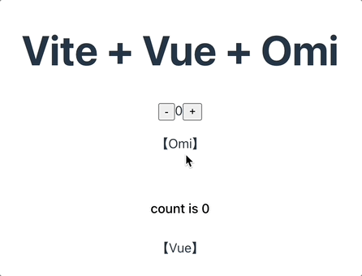
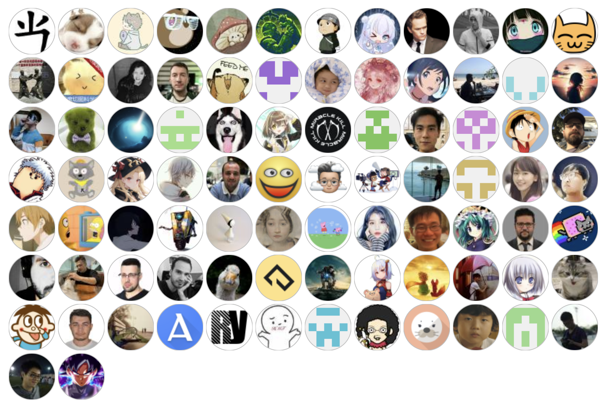

[English](./README.md) | 简体中文 

<p align="center"></p>
<h2 align="center">Omi - Web Components 框架</h2>

- 📶 信号 **Signal** 驱动的响应式编程，[reactive-signal](https://github.com/Tencent/omi/tree/master/packages/reactive-signal)强力驱动
- 🧱 [TDesign Web 组件](https://github.com/TDesignOteam/tdesign-web-components) & [OMI 游乐场](https://omi.cdn-go.cn/tutorial/latest/)
- ⚡ **微小的**尺寸，**极速的**性能
- 💗 [目标 100+ 模板](https://omi.cdn-go.cn/templates/latest/) & [OMI 模板源码](https://github.com/Tencent/omi/tree/master/packages/omi-templates)
- 🐲 [OMI Form](https://omi.cdn-go.cn/form/latest/docs/) & [OMI Form 游乐场](https://omi.cdn-go.cn/form/latest/play/) & [Lucide Omi 图标](https://github.com/omijs/lucide-omi)
- 🌐 你要的一切都有: **Web Components**, **JSX**, Function Components, Router, Suspense, Directive, Tailwindcss...
- 💒 使用 **Constructable Stylesheets** 轻松管理和共享样式

```tsx
import { render, signal, tag, Component, h } from 'omi'

const count = signal(0)

function add() {
  count.value++
}

function sub() {
  count.value--
}

@tag('counter-demo')
export class CounterDemo extends Component {
  static css = 'span { color: red; }'

  render() {
    return (
      <>
        <button onClick={sub}>-</button>
        <span>{count.value}</span>
        <button onClick={add}>+</button>
      </>
    )
  }
}
```

使用该组件:

```tsx
import { h } from 'omi'
import './counter-demo'

render(<counter-demo />, document.body)

// 或者
import { CounterDemo, Other } from './counter-demo'
// 当需要导入其他东西的时候，防止被 tree shaking
render(<CounterDemo />, document.body)

// 或者
document.body.appendChild(document.createElement('counter-demo'))
```

## 安装

```bash
npm i omi
```

快速创建 Omi + Vite + TS/JS 项目：

```bash
$ npx omi-cli init my-app    # 或者创建js项目: npx omi-cli init-js my-app
$ cd my-app           
$ npm start           # develop
$ npm run build       # release
```

快速创建 Omi + **Router** + **Signal** + **Suspense** + **Tailwindcss** + Vite + TS 项目：

```bash
$ npx omi-cli init-spa my-app  
$ cd my-app           
$ npm start           # develop
$ npm run build       # release
```

### 包

- 核心包
  - [`omi`](https://github.com/Tencent/omi/tree/master/packages/omi) - Omi 框架的实现代码。
  - [`lucide-omi`](https://github.com/omijs/lucide-omi) - Lucide 的 Omi 图标集合。
  - [`omiu`](https://github.com/Tencent/omi/tree/master/packages/omiu) - 希望打造最好的 web 组件。
  - [`omi-router`](https://github.com/Tencent/omi/tree/master/packages/omi-router) - 创建单页应用。
  - [`omi-cli`](https://github.com/omijs/cli) - 快速创建 Omi + Vite + TS/JS 项目。
- 入门套件 (未发布到 npm)
  - [`omi-elements`](https://github.com/Tencent/omi/tree/master/packages/omi-elements) - 官方推出 Tailwind Omi 套件。
  - [`omi-starter-spa`](https://github.com/Tencent/omi/tree/master/packages/omi-starter-spa) - 快速创建单页应用(SPA)，内置了 Omi + OmiRouter + Tailwindcss + TypeScript + Vite + Prettier。
  - [`omi-starter-ts`](https://github.com/Tencent/omi/tree/master/packages/omi-starter-ts) - 基于 Vite + Omi + TypeScript 的模板。
  - [`omi-starter-tailwind`](https://github.com/Tencent/omi/tree/master/packages/omi-starter-tailwind) - 基于 Vite + Omi + TypeScript + Tailwindcss 的模板。
  - [`omi-starter-js`](https://github.com/Tencent/omi/tree/master/packages/omi-starter-js) - 基于 Vite + Omi + JavaScript 的模板。
  - [`omi-vue`](https://github.com/Tencent/omi/tree/master/packages/omi-vue) - Vue SFC + Vite + OMI + OMI-WeUI.
- 组件
  - [`omi-weui`](https://github.com/Tencent/omi/tree/master/packages/omi-weui) - Omi 版本的 WeUI。
  - [`omi-auto-animate`](https://github.com/Tencent/omi/tree/master/packages/omi-auto-animate) - Omi 版本的 @formkit/auto-animate。
  - [`omi-suspense`](https://github.com/Tencent/omi/tree/master/packages/omi-suspense) - 处理异步依赖。
- 指令  
  - [`omi-transition`](https://github.com/Tencent/omi/tree/master/packages/omi-transition) - 提供进入和离开动画。
  - [`omi-ripple`](https://github.com/Tencent/omi/tree/master/packages/omi-ripple) - 用于为用户界面元素添加涟漪（ripple）效果。当用户与元素交互（例如点击按钮）时，涟漪效果会从交互点开始扩散开来。
- 综合性例子 (未发布到 npm)
  - [`snake-game-3tier`](https://github.com/Tencent/omi/tree/master/packages/snake-game-3tier) - 基于 Omi 响应是函数三层架构的贪吃蛇游戏。
  - [`omi-tutorial`](https://github.com/omijs/tutorial) - Omi 官方教程源代码。

**如果你想帮助项目发展，可以先简单地与同行分享!**

- [Share via Dev.to](<https://dev.to/new?prefill=---%0Atitle%3A%20Omi%20-%20Web%20Components%20Framework%0A---- %20Home%3A%20%5Bomijs.org%5D(http%3A%2F%2Fomijs.org%2F)%20Github%3A%5Bhttps%3A%2F%2Fgithub.com%2FTencent%2Fomi%5D(https%3A%2F%2Fgithub.com%2FTencent%2Fomi)%0A-%20%F0%9F%93%B6%20**Signal**-driven%20reactive%20programming%0A-%20%F0%9F%8E%89%20%5BTailwind%20Element%20Omi%20UI%20KIT%5D(https%3A%2F%2Fomi.cdn-go.cn%2Felements%2Flatest%2F)%0A-%20%E2%9A%A1%20**Tiny**%20size%2C%20**Fast**%20performance%0A-%20%F0%9F%8C%90%20Everything%20you%20need%3A%20**Web%20Components**%2C%20**JSX**%2C%20Router%2C%20Suspense%2C%20Directive%2C%20Tailwindcss...%0A-%20%F0%9F%92%AF%20Both%20**object**%20oriented%20programming(OOP)%20and%20**data**%20oriented%20programming(DOP)%20are%20supported%0A-%20%F0%9F%92%92%20Harness%20**Constructable%20Stylesheets**%20to%20easily%20manage%20and%20share%20styles>)
- [Share via Twitter](https://twitter.com/intent/tweet?text=Web%20Components%20Framework%20%F0%9F%8E%89http%3A%2F%2Fomijs.org%2F%0A%0A%20Everything%20you%20need%3A%20Web%20Components%2C%20JSX%2C%20Router%2C%20Suspense%2C%20Directive%2C%20Tailwindcss...%20%0A%0A%20Tailwind%20Element%20Omi%20UI%20KIT%3E%20%F0%9F%92%AFhttps%3A%2F%2Fomi.cdn-go.cn%2Felements%2Flatest%2F)
- [Share via Facebook](https://www.facebook.com/sharer/sharer.php?u=http%3A//omijs.org)
- [Share via LinkedIn](http://www.linkedin.com/shareArticle?url=http%3A%2F%2Fomijs.org%2F)
- [Share via Pinterest](https://www.pinterest.com/pin/create/button?url=http://omijs.org/&media=https://repository-images.githubusercontent.com/36606437/66abfcfb-096b-4c9d-a290-77165213e605&description=Omi-Web%20Componnets%20Framework)
- [Share via Reddit](https://reddit.com/submit?url=http://omijs.org/&title=web%20components%20framework)
- [Share via StumbleUpon](https://www.stumbleupon.com/submit?url=http://omijs.org/&title=web%20components%20framework)
- [Share via Vkontakte](https://vk.com/share.php?url=http://omijs.org/)
- [Share via Weibo](https://service.weibo.com/share/share.php?url=https://omijs.org/&title=web%20components%20framework)
- [Share via Hackernews](https://news.ycombinator.com/submitlink?u=http://omijs.org/&t=web%20components%20framework)

多谢！

## 使用

### TodoApp 使用响应式函数

> 数据驱动编程

在数据驱动编程中，我们将重点放在数据本身和对数据的操作上，而不是数据所在的对象或数据结构。这种编程范式强调的是数据的变化和流动，以及如何响应这些变化。基于响应式函数的 TodoApp 就是一个很好的例子，它使用了响应式编程的概念，当数据（即待办事项列表）发生变化时，UI 会自动更新以反映这些变化。


```tsx
import { render, signal, computed, tag, Component, h } from 'omi'

const todos = signal([
  { text: 'Learn OMI', completed: true },
  { text: 'Learn Web Components', completed: false },
  { text: 'Learn JSX', completed: false },
  { text: 'Learn Signal', completed: false }
])

const completedCount = computed(() => {
  return todos.value.filter(todo => todo.completed).length
})

const newItem = signal('')

function addTodo() {
  // api a，不会重新创建数组
  todos.value.push({ text: newItem.value, completed: false })
  todos.update() // 非值类型的数据更新需要手动调用 update 方法

  // api b, 和上面的 api a 效果一样，但是会创建新的数组
  // todos.value = [...todos.value, { text: newItem.value, completed: false }]

  newItem.value = '' // 值类型的数据更新需会自动 update
}

function removeTodo(index: number) {
  todos.value.splice(index, 1)
  todos.update() // 非值类型的数据更新需要手动调用 update 方法
}

@tag('todo-list')
class TodoList extends Component {
  onInput = (event: Event) => {
    const target = event.target as HTMLInputElement
    newItem.value = target.value
  }

  render() {
    return (
      <>
        <input type="text" value={newItem.value} onInput={this.onInput} />
        <button onClick={addTodo}>Add</button>
        <ul>
          {todos.value.map((todo, index) => {
            return (
              <li>
                <label>
                  <input
                    type="checkbox"
                    checked={todo.completed}
                    onInput={() => {
                      todo.completed = !todo.completed
                      todos.update()
                    }}
                  />
                  {todo.completed ? <s>{todo.text}</s> : todo.text}
                </label>
                {' '}
                <button onClick={() => removeTodo(index)}>❌</button>
              </li>
            )
          })}
        </ul>
        <p>Completed count: {completedCount.value}</p>
      </>
    )
  }
}

render(<todo-list />, document.body)
```


## 自动导入 h

vite.config.js:

```tsx
import { defineConfig } from 'vite'

export default defineConfig({
  esbuild: {
    jsxInject: "import { h } from 'omi'",
    jsxFactory: "h",
    jsxFragment: "h.f"
  }
})
```

你可以在构建时候注入代码，这样就不用手动导出 `h`。

## 定义跨框架组件

在 Vue 中使用 Omi component 例子如下:



my-counter.tsx:

```tsx
import { tag, Component, h, bind } from 'omi'

@tag('my-counter')
class MyCounter extends Component<{ count: number }> {
  static props = {
    count: {
      type: Number,
      default: 0,
      changed(newValue, oldValue) {
        this.setState({ count: newValue })
      }
    }
  }

  state = {
    count: 1
  }

  @bind
  sub() {
    this.setState({ count: this.state.count - 1 })
    this.fire('change', this.state.count)
  }

  @bind
  add() {
    this.setState({ count: this.state.count + 1 })
    this.fire('change', this.state.count)
  }

  render() {
    return (
      <>
        <button onClick={this.sub}>-</button>
        <span>{this.state.count}</span>
        <button onClick={this.add}>+</button>
      </>
    )
  }
}
```

### 在 Vue3 中使用

```vue
<script setup>
import { ref } from 'vue'
// 导入 omi 组件
import './my-counter'

defineProps({
  msg: String,
})

const count = ref(0)

const change = (e) => {
  count.value = e.detail
}

</script>

<template>
  <h1>{{ msg }}</h1>

  <my-counter @change="change" :count="count" />
  <p>
    【Omi】 
  </p>

  <div class="card">
    <button type="button" @click="count++">count is {{ count }}</button>
    <p>
     【Vue】 
    </p>
  </div>

</template>
```

如果在 omi 组件中使用:

```ts
this.fire('count-change', this.state.count)
```

在 vue 中使用组件监听事件如下:

```html
<my-counter @count-change="change" :count="count" />
```


### 在 React 中使用

```tsx
import { useState, useRef, useEffect } from 'react'
import useEventListener from '@use-it/event-listener'
import './my-counter'

function App() {
  const [count, setCount] = useState(100)
  const myCounterRef = useRef(null)

  useEffect(() => {
    const counter = myCounterRef.current
    if (counter) {
      const handleChange = (evt) => {
        setCount(evt.detail)
      }
      counter.addEventListener('change', handleChange)
      return () => {
        counter.removeEventListener('change', handleChange)
      }
    }
  }, [])

  return (
    <>
      <h1>Omi + React</h1>
      <my-counter count={count} ref={myCounterRef}></my-counter>
      <div className="card">
        <button onClick={() => setCount((count) => count + 1)}>
          count is {count}
        </button>
      </div>
    </>
  )
}

export default App
```

## 贡献者

<a href="https://github.com/Tencent/omi/graphs/contributors">
  
</a>

## License

MIT © Tencent


  <!-- - [`tdesign-omi`](https://github.com/omijs/tdesign) - `[进行中...]`基于 TDesign 和 Omi 的跨框架 组件 集合。 [点击这里预览一下](https://omijs.github.io/tdesign/) -->
